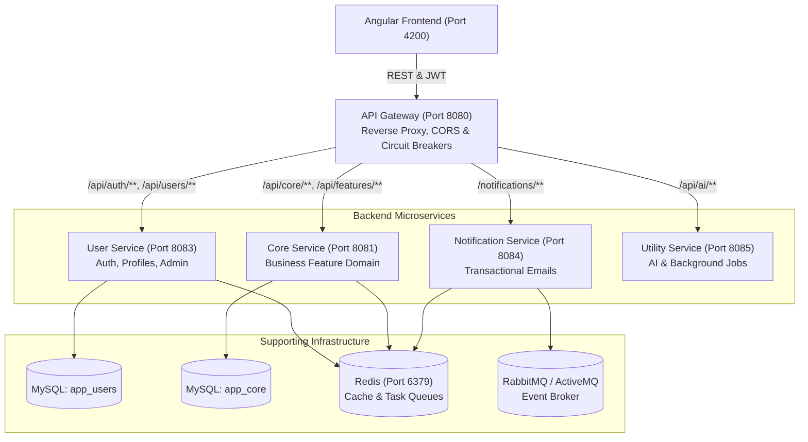

# Full-Stack Application Architecture

## 1. Overview

This project is organized as a modular, scalable full-stack application template following the **Database-per-Service** and **API Gateway** microservices patterns, coupled with a modern Angular frontend.

---

## 2. Component Details

### Frontend (`Frontend/`)
* **Framework**: Angular 18 (Standalone Components, Signals, Router, OnPush Change Detection).
* **Styling**: Tailwind CSS with custom glassmorphism and responsive design tokens.
* **State Management**: Lightweight signal-based store (`AppStore`) backed by RxJS BehaviorSubjects for asynchronous pipelines.
* **Security**: HTTP Auth Interceptors attach Bearer JWT tokens; Angular route guards (`authGuard`) enforce authentication.

### API Gateway (`Backend/api-gateway`)
* **Framework**: Spring Cloud Gateway (Spring Boot 3, Java 21).
* **Port**: `8080`.
* **Responsibilities**:
  - Global entry point for all frontend requests.
  - Path-based routing to downstream microservices.
  - Centralized CORS and security header management.
  - Resilience4j Circuit Breakers and Fallbacks.
  - Request logging and distributed tracing (Zipkin / Micrometer).

### User Service (`Backend/user-service`)
* **Framework**: Spring Boot 3, Spring Security, Spring Data JPA.
* **Port**: `8083`.
* **Responsibilities**:
  - Local authentication: registration, email verification, login, password reset.
  - OAuth2 social login (Google OAuth2).
  - JWT token generation and validation (`JwtUtil`).
  - User profile management and administrative user listing/status updates.
  - Dedicated database: `app_users`.

### Core Service (`Backend/core-service`)
* **Framework**: Spring Boot 3, Spring Data JPA.
* **Port**: `8081`.
* **Responsibilities**:
  - The business domain engine where application-specific logic lives.
  - Contains global exception handling, database connectivity, and sample feature structure.
  - Dedicated database: `app_core`.

### Notification Service (`Backend/notification-service`)
* **Framework**: Spring Boot 3, Spring Mail, Thymeleaf.
* **Port**: `8084`.
* **Responsibilities**:
  - Queue-driven async email dispatching (via Redis queue `email-notifications`).
  - HTML templated emails (Thymeleaf engine).

### Utility Service (`Backend/utility-service`)
* **Framework**: Spring Boot 3.
* **Port**: `8085`.
* **Responsibilities**:
  - Modular utility gateway for AI inference (HuggingFace / OpenAI-compatible APIs).
  - Background processing and third-party integrations.

---

## 3. Communication Patterns

1. **Synchronous (Request/Response)**:
   - Frontend communicates with the backend exclusively via the API Gateway (`http://localhost:8080`).
   - Downstream service-to-service communication uses Spring Cloud OpenFeign or Spring WebClient.
2. **Asynchronous (Queue/Event)**:
   - Background tasks (e.g. sending emails or data archiving) push JSON payloads to Redis lists or RabbitMQ exchanges.
   - Workers pick up jobs asynchronously, keeping user requests sub-millisecond.

---

## 4. Security Architecture

* **Stateless Authentication**: Users receive a signed JWT token upon login/verification.
* **Token Storage**: Frontend stores JWT in localStorage and attaches it via HTTP Bearer authorization headers.
* **Gateway Validation**: Gateway validates incoming tokens or propagates `Authorization: Bearer <token>` to downstream services.
* **Password Hashing**: Passwords stored using BCrypt (`BCryptPasswordEncoder`).
